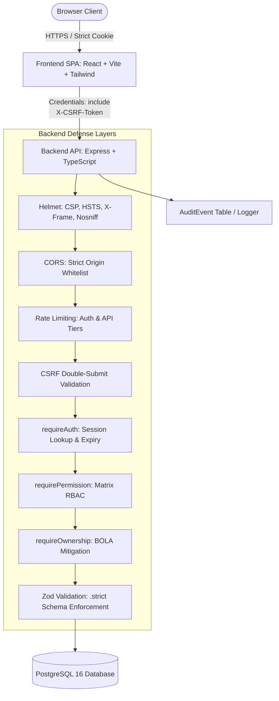

# SecureAuth — Secure Full-Stack Application Security Lab

[](https://github.com/ayus1n9/SecureAuth/actions)
[](LICENSE)
[](docs/owasp-top10-mapping.md)
[](https://www.typescriptlang.org/)
[](https://nodejs.org/)
[](https://www.docker.com/)

> **SecureAuth** is an enterprise-grade full-stack web application engineering laboratory demonstrating practical application security: server-managed stateful sessions, server-enforced role-based access control (RBAC), strict object-level authorization (BOLA/IDOR prevention), defense-in-depth browser protections (CSRF, CORS, CSP/Helmet, rate limiting), structured security logging with sensitive data redaction, 44 automated security tests, and reproducible before-and-after OWASP ZAP dynamic application security testing (DAST).

---

## 1. Problem Statement

Many modern web tutorials reduce web application security to installing a few middleware packages or issuing stateless JWTs stored insecurely in `localStorage`. In real enterprise environments, this creates critical vulnerabilities:
- **Stateless Tokens**: Inability to revoke sessions instantly upon credential rotation, privilege demotion, or account compromise.
- **Client-Side "Authorization"**: Hiding UI buttons while failing to verify object ownership (`WHERE id = :id AND userId = :currentUserId`) on the server, resulting in Broken Object-Level Authorization (BOLA/IDOR).
- **Overly Broad Roles**: Giving support or administrative operators universal permissions without separation of duties.
- **Information Leakage**: Exposing internal database stack traces, password hashes, or sensitive tokens in API responses and log streams.

**SecureAuth** was engineered specifically to solve and demonstrate defense-in-depth mitigations for these core application security challenges.

---

## 2. Architecture & Trust Boundaries



---

## 3. Technology Stack

- **Frontend**: React 18, TypeScript, Vite, Tailwind CSS, Lucide Icons.
- **Backend API**: Node.js v24, Express, TypeScript, Prisma ORM.
- **Database**: PostgreSQL 16 (Alpine).
- **Authentication**: Server-managed stateful sessions, Argon2id password hashing, cryptographically random 256-bit session tokens, `HttpOnly` / `SameSite=lax` cookies.
- **Browser Security**: Helmet (CSP `frame-ancestors 'none'`, `nosniff`, `X-Frame-Options: DENY`), Double-Submit signed CSRF tokens (`X-CSRF-Token`), Strict CORS whitelist.
- **Logging & Auditing**: Pino structured JSON logger with automatic credential redaction, persistent PostgreSQL `AuditEvent` trail.
- **Validation**: Zod runtime schema validation with `.strict()` mode (preventing mass-assignment attacks).
- **Testing**: Vitest, Supertest, OWASP ZAP (DAST).
- **Containerization & CI/CD**: Docker (multi-stage non-root containers), Docker Compose, GitHub Actions (SAST with Semgrep, Secrets scanning with Gitleaks, Container scanning with Trivy).

---

## 4. Role-Based Access Control (RBAC) Matrix

Every protected endpoint is enforced by backend middleware (`requirePermission`), following the **Principle of Least Privilege**:

| Permission | Action Description | USER | SUPPORT | ADMIN |
| :--- | :--- | :---: | :---: | :---: |
| `profile:read:self` | View own user account details | ✅ | ✅ | ✅ |
| `profile:update:self` | Modify personal profile fields (Full Name) | ✅ | ✅ | ✅ |
| `records:create:self` | Create private encrypted records | ✅ | ✅ | ✅ |
| `records:read:self` | View owned private records | ✅ | ✅ | ✅ |
| `records:update:self` | Modify owned private records | ✅ | ✅ | ✅ |
| `records:delete:self` | Delete owned private records | ✅ | ✅ | ✅ |
| `support:read` | Inspect customer support queue | ❌ | ✅ | ✅ |
| `users:read_minimal` | View sanitized user directory (name, email) | ❌ | ✅ | ✅ |
| `users:read` | View full administrative user profiles (counts, lockouts) | ❌ | ❌ | ✅ |
| `users:change_role` | Promote/demote user roles (with self-demotion lock) | ❌ | ❌ | ✅ |
| `admin:dashboard` | Inspect system overview and security metrics | ❌ | ❌ | ✅ |
| `audit:read` | Inspect live security audit event stream | ❌ | ❌ | ✅ |

### Server-Enforced Object Ownership (BOLA/IDOR Prevention)
For all record queries (`GET`, `PUT`, `DELETE` on `/api/v1/records/:id`), the database query strictly binds both the record ID and the authenticated user's ID:
```typescript
const record = await prisma.record.findFirst({
  where: { id: req.params.id, userId: req.user.id }
});
if (!record) {
  // Returns 404 to avoid leaking valid object IDs to unauthorized users
  return res.status(404).json({ error: 'Not Found', message: 'Record not found or access denied' });
}
```

---

## 5. OWASP Top 10:2025 Mitigation Summary

| Category | Technical Mitigation Implemented | Verified In Code |
| :--- | :--- | :--- |
| **A01:2025 Broken Access Control** | Centralized RBAC middleware + strict query ownership constraints (`WHERE userId = req.user.id`). | `tests/integration/idor.test.ts`, `authorization.test.ts` |
| **A02:2025 Security Misconfiguration** | Helmet CSP (`frame-ancestors 'none'`), `nosniff`, `X-Frame-Options: DENY`, `Server` banner removed. | `tests/integration/browser-security.test.ts` |
| **A03:2025 Supply Chain Failures** | Pinned lockfiles, scripts blocked by default in npm 12, Trivy container scanning in CI. | `.github/workflows/security-ci.yaml` |
| **A04:2025 Cryptographic Failures** | Argon2id password hashing (memory cost 64MB, time cost 3), 256-bit session entropy, HMAC-SHA256 CSRF. | `tests/unit/password.test.ts`, `browser-security.test.ts` |
| **A05:2025 Injection** | Parameterized Prisma ORM queries, Zod `.strict()` schema validation, JSX escaping. | `tests/integration/input-validation.test.ts` |
| **A06:2025 Insecure Design** | Threat model, constant-time dummy verify on nonexistent users, double-submit CSRF, admin self-demotion guard. | `docs/threat-model.md`, `tests/integration/auth.test.ts` |
| **A07:2025 Authentication Failures** | Stateful sessions with rotation on login, IP rate limiting (5 per 15 min), device session revocation on pwd change. | `tests/integration/auth.test.ts`, `rate-limit.test.ts` |
| **A08:2025 Integrity Failures** | Cryptographically signed HMAC CSRF tokens, strict 100kb payload caps preventing DoS. | `tests/integration/input-validation.test.ts` |
| **A09:2025 Logging & Alerting** | Pino structured JSON logging with password/token redaction, PostgreSQL `AuditEvent` table, Admin log viewer. | `tests/integration/logging-audit.test.ts` |
| **A10:2025 Exceptional Conditions** | Fail-closed global error handler, internal DB stack traces stripped, malformed JSON body handling. | `src/middleware/security.ts`, `input-validation.test.ts` |

---

## 6. Getting Started

### Prerequisites
- Node.js >= 20 (v24 recommended)
- Docker & Docker Compose
- Git

### Quick Start (Local Docker Compose)
```bash
# Clone the repository
git clone https://github.com/ayus1n9/SecureAuth.git
cd SecureAuth

# Start PostgreSQL, Backend, and Frontend in background
docker compose up -d --build

# Open the frontend application in your browser
# URL: http://localhost:8080
```

### Development Setup (Local Node + Docker DB)
```bash
# 1. Start the local database
docker run -d --name secureauth-dev-db \
  -e POSTGRES_USER=secureauth \
  -e POSTGRES_PASSWORD=secureauth_dev_secret \
  -e POSTGRES_DB=secureauth_db \
  -p 5432:5432 \
  postgres:16-alpine

# 2. Setup and seed backend
cd backend
npm install
npx prisma db push
npm run seed     # Seeds demo accounts: admin, support, alice, bob

# 3. Start backend API (listening on port 5000)
npm run dev

# 4. In a separate terminal, start frontend (listening on port 5173)
cd ../frontend
npm install
npm run dev
```

### Demo Accounts Seeded
- **Admin**: `admin@secureauth.local` / `Password123!@#`
- **Support**: `support@secureauth.local` / `Password123!@#`
- **User (Alice)**: `alice@secureauth.local` / `Password123!@#`
- **User (Bob)**: `bob@secureauth.local` / `Password123!@#`

---

## 7. Automated Security Testing

Run the full suite of 44 automated security tests:
```bash
cd backend
npm test
```

Test Results Breakdown:
- **Unit Tests**: 8 passed (Argon2id hashing, unique salts, constant-time verification, RBAC permissions matrix).
- **Integration Tests**: 36 passed (Authentication lifecycle, session rotation, RBAC authorization, BOLA/IDOR prevention, input validation, SQL injection safety, browser security headers, CORS origin rejection, CSRF signed token verification, structured logging redaction, rate limiting).
- **Execution Time**: ~4.8 seconds.

---

## 8. OWASP ZAP Before-and-After DAST Assessment

SecureAuth provides an automated, reproducible before-and-after assessment using official **OWASP ZAP** (`ghcr.io/zaproxy/zaproxy:stable`):

```bash
./scripts/run-zap-assessment.sh
```

1. **Baseline Scan (`security/fixtures/vulnerable-baseline.ts`)**:
   Runs on `http://127.0.0.1:5001`, intentionally demonstrating missing CSP, missing anti-clickjacking headers, missing `nosniff`, permissive CORS, unhardened cookies, and exposed debug endpoints.
   - Output: `reports/zap-baseline-report.json` and `.html`
2. **Hardened Scan (`backend/src/server.ts`)**:
   Runs on `http://127.0.0.1:5000`, demonstrating complete remediation via Helmet, strict CORS, signed CSRF, secure cookies, and redacted endpoints.
   - Output: `reports/zap-hardened-report.json` and `.html`
3. **Findings Comparison**: See [docs/zap-assessment.md](docs/zap-assessment.md).

---

## 9. Security Documentation Links

- [Architecture & Design](docs/architecture.md)
- [STRIDE Threat Model](docs/threat-model.md)
- [Authentication & Session Security](docs/authentication-and-sessions.md)
- [RBAC Authorization Matrix](docs/authorization-matrix.md)
- [OWASP Top 10:2025 Mapping](docs/owasp-top10-mapping.md)
- [Automated Security Testing](docs/security-testing.md)
- [OWASP ZAP Assessment Report](docs/zap-assessment.md)
- [Containerization & Deployment](docs/deployment.md)
- [Known Limitations](docs/limitations.md)
- [Vulnerability Disclosure Policy](SECURITY.md)

---

## 10. License

This project is licensed under the MIT License — see the [LICENSE](LICENSE) file for details.
