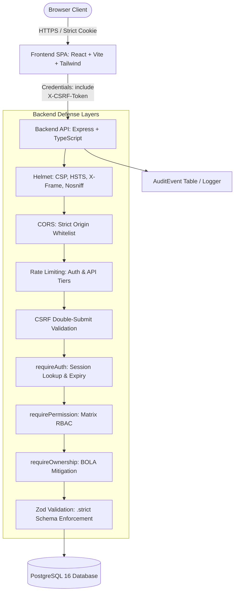
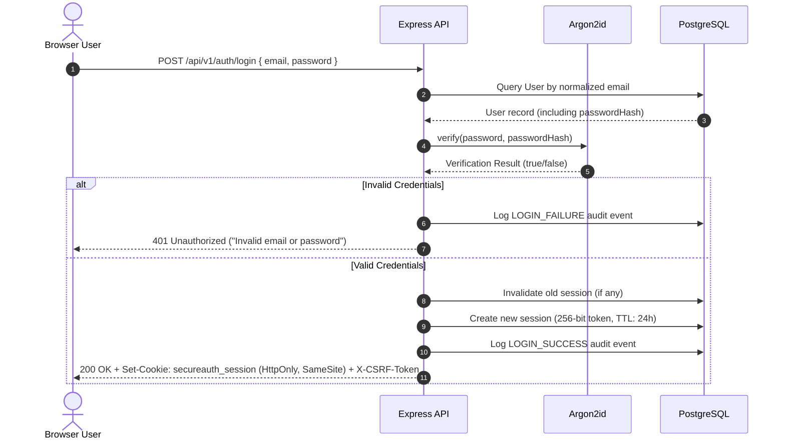

# SecureAuth — Architecture & Threat Mitigation Design

## 1. System Architecture Overview

SecureAuth is built with a decoupled, defense-in-depth architecture consisting of a React + TypeScript Single Page Application (SPA), a hardened Express REST API, and a PostgreSQL database accessed via Prisma ORM.

## 2. Trust Boundaries & Data Flow

1. **Client / Browser (Untrusted Zone)**:
   - Untrusted environment. Client-side state, form fields, URL parameters, headers, and local storage cannot be relied upon for security decisions.
   - All authorization and validation decisions are strictly enforced on the server.

2. **Transport Layer (Network Boundary)**:
   - In production, protected via TLS 1.3.
   - Session identifiers are carried exclusively in `HttpOnly`, `SameSite=lax`, `Secure` cookies.
   - CSRF tokens are carried via an HMAC-signed cookie and an explicit `X-CSRF-Token` request header for state-changing HTTP operations.

3. **Application Layer (Express / Node.js)**:
   - Enforces rate limiting at the IP and credential level.
   - Validates all request inputs via Zod with `.strict()` mode.
   - Generates and verifies cryptographic session tokens (256-bit entropy).
   - Enforces the RBAC permission matrix (`USER`, `SUPPORT`, `ADMIN`).
   - Verifies resource ownership on all record queries (`WHERE id = :id AND userId = :currentUserId`).

4. **Persistence Layer (PostgreSQL)**:
   - Relational database schema with strict foreign key constraints, cascading deletes, and unique indexes on email.
   - Access parameterized via Prisma query engine, mitigating SQL injection risks.

## 3. Session & Credential Lifecycle

